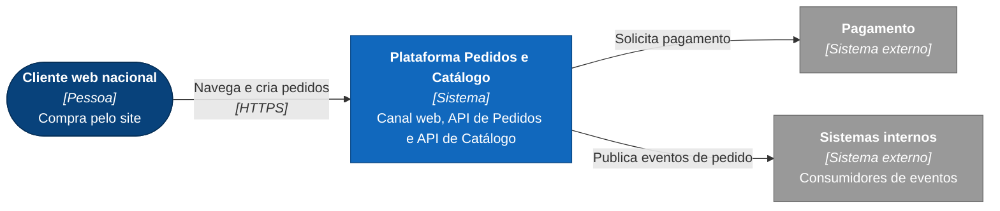
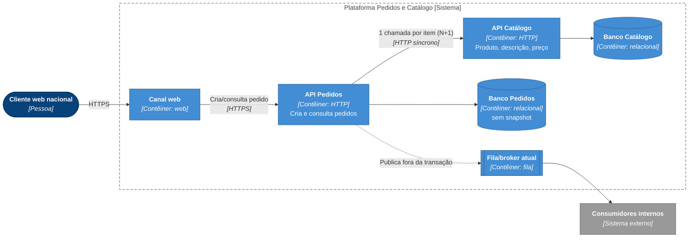
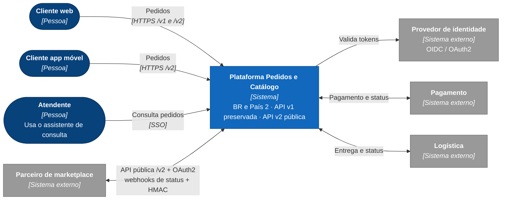
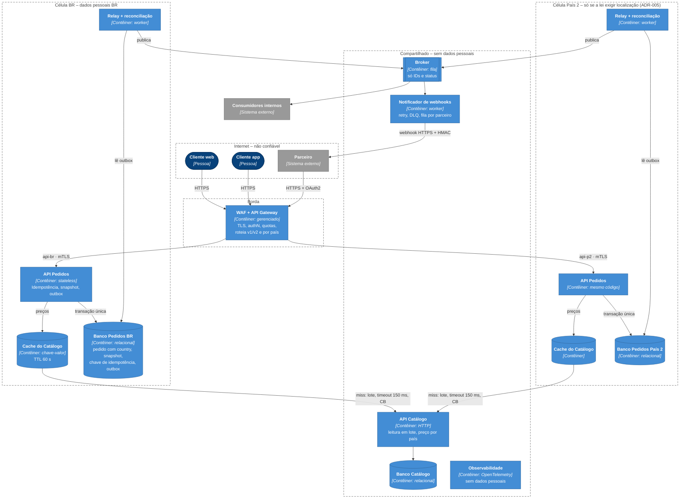
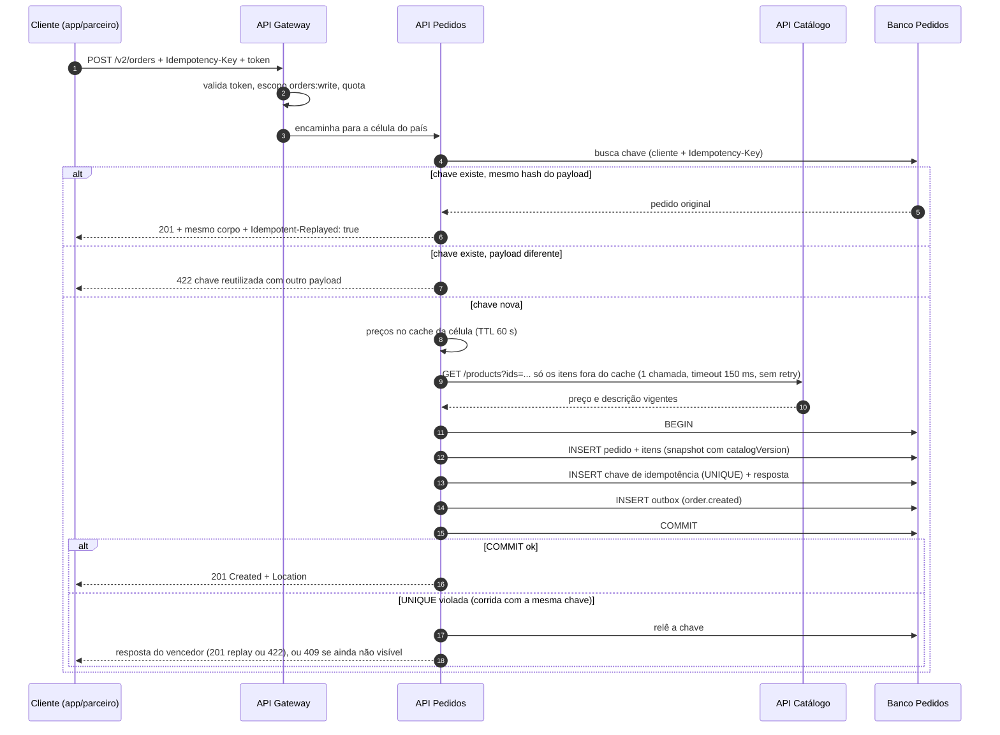
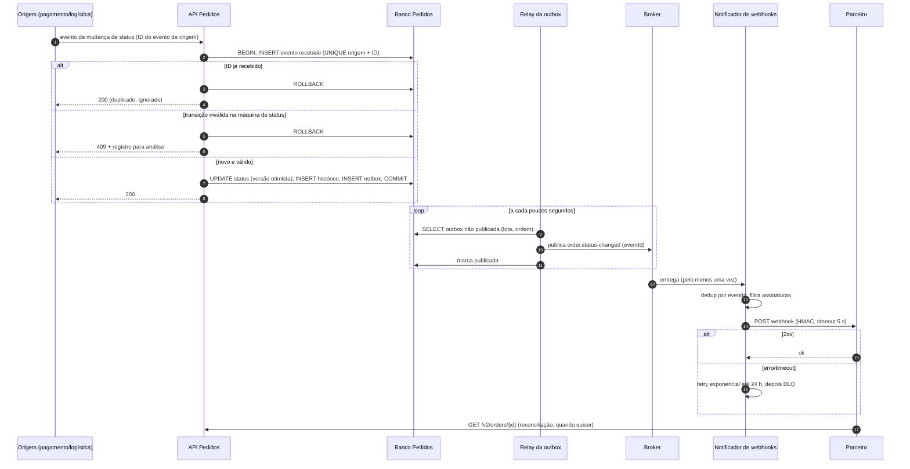

# 02 – Arquitetura atual e alvo

> **Para o avaliador**  
> **Item do PDF:** 2.3.1 Visões arquiteturais  
> **Critério de avaliação:** Arquitetura de solução  
> **O que conferir aqui:** C4 atual (§1–§2) e alvo (§3–§4); fronteiras de confiança (§5); pontos de falha (§2 e §6); atributo de qualidade → mecanismo (§7); sequências de criação (§8) e de status (§9).

Notação: modelo C4, níveis 1 (Contexto) e 2 (Contêineres), em Mermaid. Usei `flowchart` com o visual oficial do C4 (cores, estereótipo entre colchetes, fronteiras tracejadas). Testei a sintaxe nativa `C4Context`/`C4Container`: ela é marcada como experimental no Mermaid e, com o layout em grade fixa, sobrepôs rótulos e cruzou setas sobre as caixas no diagrama alvo. O `flowchart` roteia as setas e continua versionável e renderizado pelo GitHub.

| Visual | Elemento C4 |
|--------|-------------|
| Azul-escuro, arredondado | Pessoa |
| Azul | Sistema em foco (contexto) ou contêiner |
| Cilindro | Contêiner de dados (banco, cache) |
| Caixa com barras laterais | Broker / fila |
| Cinza | Sistema externo |
| Moldura tracejada | Fronteira de confiança ou célula |
| Rótulo da seta | Interação e, entre colchetes, o protocolo |

## 1. Contexto – atual

## 2. Contêineres – atual

Pontos de falha atuais:

| Ponto | Falha | Efeito |
|-------|-------|--------|
| Pedidos → Catálogo | Lento ou fora | Criação de pedido lenta ou falha (cascata) |
| Retry do cliente | Timeout na resposta | Pedido duplicado |
| Commit + publish | Um ocorre, o outro não | Evento perdido ou evento de pedido inexistente |
| Banco único de Pedidos | Indisponível | Toda a plataforma para |

## 3. Contexto – alvo

## 4. Contêineres – alvo

Segundo país ([ADR-005](adr/ADR-005-residencia-de-dados-por-celula.md)): se o parecer jurídico permitir transferência internacional (opção A), a célula País 2 não existe e os pedidos do País 2 ficam no banco BR com `country = <país>`. Se exigir localização (opção B), só sobe a célula mínima acima. Broker e notificador não são duplicados, porque os eventos não têm dado pessoal.

Componentes e responsabilidades:

| Contêiner | Onde roda | Responsabilidade | Dono dos dados |
|-----------|-----------|------------------|----------------|
| WAF + API Gateway | Compartilhado | TLS, WAF, autenticação, quotas, roteamento por versão e por país | – |
| API Pedidos | Por célula | Criar/consultar pedido, idempotência, snapshot, gravar outbox | Pedidos |
| Relay da outbox + reconciliação | Por célula (lê o banco local) | Publica a outbox no broker e marca como publicado; detecta outbox parada e pedidos sem evento | Pedidos |
| Cache do Catálogo | Por célula | Preço e descrição vigentes perto da API, sem atravessar regiões | Catálogo |
| Broker | Compartilhado | Distribui eventos de status (só IDs e status) | – |
| Notificador de webhooks | Compartilhado | Entrega eventos a parceiros com retry, DLQ e fila por parceiro | Notificações |
| API Catálogo | Compartilhado | Produto, descrição, preço vigente por país; leitura em lote | Catálogo |
| Observabilidade | Compartilhado | Traces, métricas, logs (sem dados pessoais) | Plataforma |

Dependências externas: provedor de identidade, pagamento, logística, endpoints dos parceiros (não confiáveis).

## 5. Fronteiras de confiança

| Fronteira | O que cruza | Controle |
|-----------|-------------|----------|
| Internet → Borda | Requisições de web, app, parceiros | TLS 1.2+, WAF, OAuth2/JWT, quotas |
| Borda → Célula | Requisição autenticada | mTLS interno, claims propagadas (cliente, escopos, país) |
| Célula → Compartilhado | IDs de produto e país (Catálogo); eventos com IDs e status (broker) | Nenhum dado pessoal sai da célula; schema do evento checado no CI (`Eventos_nao_carregam_dado_pessoal`) |
| Célula → Parceiro (webhook) | Evento de status | HMAC, só IDs e status, URL cadastrada e validada |
| Célula → Observabilidade | Telemetria | Mascaramento de dados pessoais no coletor |

## 6. Pontos de falha no alvo

| Ponto | Mitigação | Degradação |
|-------|-----------|------------|
| Catálogo lento/fora | Lote, cache na célula, timeout, circuit breaker | Usa o último preço em cache (até 15 min); sem cache → 503 com `Retry-After` (seguro por causa da idempotência) |
| Broker (compartilhado) fora | Outbox de cada célula acumula no banco | Eventos atrasam nos dois países; pedidos continuam sendo criados |
| Endpoint do parceiro fora | Retry com backoff, DLQ | Parceiro reconcilia via `GET /v2/orders/{id}` |
| Banco da célula | Réplica síncrona na mesma região, failover | Célula afetada indisponível; outra célula segue |
| Gateway | Múltiplas zonas | – |

## 7. Atributos de qualidade → mecanismos

| Atributo | Mecanismos |
|----------|-----------|
| Escala 10x | Leitura em lote + cache do Catálogo; Pedidos stateless com autoescala; cache do Catálogo por célula; publicação assíncrona |
| Disponibilidade 99,9% | Multi-zona; outbox desacopla broker; circuit breaker e bulkhead; deploy canário com rollback por feature flag |
| p95 500 ms na criação | 1 chamada em lote ao Catálogo; cache; orçamento de latência (ver [04](04-qualidade-e-resiliencia.md)) |
| Consistência | Idempotency-Key; snapshot + outbox na mesma transação; deduplicação por `eventId` no consumidor |
| Auditabilidade | Snapshot de preço/descrição; histórico de status; trilha de acesso |
| Segurança/LGPD | OAuth2 com escopos; coluna `country` e célula mínima por país se a lei exigir ([ADR-005](adr/ADR-005-residencia-de-dados-por-celula.md)); eventos sem dados pessoais; mascaramento em logs |
| Evolução sem quebra | `/v1` e `/v2` em paralelo; política de contratos; testes de contrato no CI |

## 8. Sequência – criação de pedido (v2)

Duas requisições simultâneas com a mesma chave: a constraint `UNIQUE` faz uma delas falhar no commit, e nada dela é gravado. Essa requisição relê a chave e devolve o pedido original (ou `422`, se o payload for outro). Não existe um estado "em processamento" gravado: o `409` só aparece no caso raro em que a releitura ainda não enxerga o vencedor, e o cliente repete com a mesma chave. Se o Catálogo falhar ou estourar o timeout, a API usa o último preço em cache (até 15 min); item sem cache responde `503` + `Retry-After`, e o cliente repete com a mesma chave sem risco de duplicar.

## 9. Sequência – atualização e notificação de status

Garantias: evento de entrada processado uma vez (deduplicação pelo ID da origem, na mesma transação da mudança); entrega pelo menos uma vez; consumidores deduplicam por `eventId`; ordem garantida por pedido (chave de partição = `orderId`); campo `version` no evento permite descartar evento antigo.
