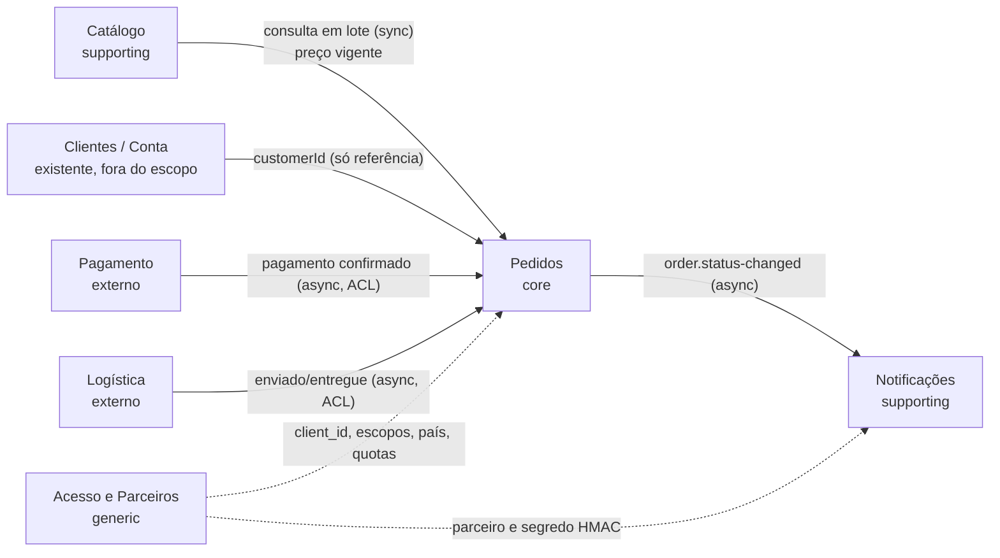
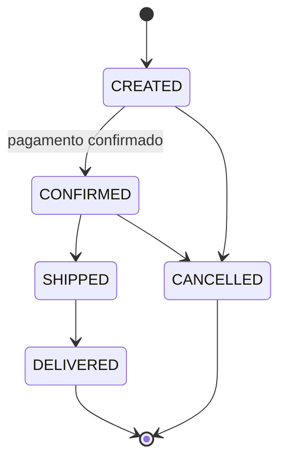
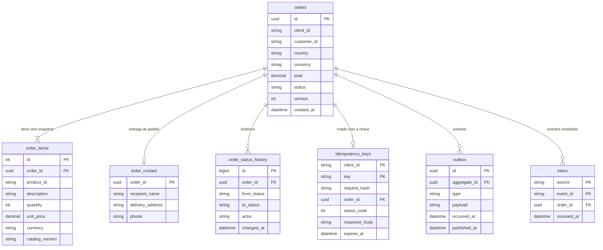

# 03 – Domínios, dados e integração

## 1. Bounded contexts

| Contexto | Subdomínio | Responsabilidade | Dados que possui | Não possui |
|----------|-----------|------------------|------------------|-----------|
| Pedidos | Core | Criar pedido, congelar snapshot, controlar status, idempotência | Pedido, item com snapshot, histórico de status, **contato e endereço de entrega daquele pedido** (dado pessoal), chave de idempotência, outbox, inbox | Cadastro do cliente, preço vigente, dados de pagamento |
| Catálogo | Supporting | Produto, descrição, preço vigente por país e moeda | Produto, preço, disponibilidade para venda | Pedido, cliente |
| Notificações | Supporting | Assinaturas de parceiros e entrega de webhooks | Assinatura, tentativa de entrega, DLQ | Conteúdo do pedido além de ID e status; dado pessoal |
| Acesso e Parceiros | Generic | Cadastro de clientes de API, credenciais, escopos, quotas, país do `client_id` | Cliente de API, plano de quota, país vinculado | Pedido |
| Clientes / Conta | Existente (fora do escopo) | Cadastro do consumidor final do web e do app | Cadastro do cliente (nome, documento, contatos) | Pedido |
| Pagamento, Logística | Externos | Integração por evento, com camada anticorrupção em Pedidos | – | – |

Quem é dono do dado do cliente:
- **Cadastro** (web e app): contexto Clientes / Conta, que já existe e não muda neste projeto. Pedidos guarda só o `customerId`.
- **Contato e endereço de entrega do pedido**: Pedidos guarda uma cópia imutável no momento da compra, pelo mesmo motivo do snapshot de preço (o pedido mostra para onde foi entregue, mesmo que o cadastro mude). É o único dado pessoal de Pedidos.
- **Pedido de parceiro**: o consumidor é cliente do parceiro. O parceiro envia contato e endereço no pedido e é o controlador desse dado; a plataforma atua como operadora (LGPD art. 5º, VI e VII), com o tratamento previsto em contrato. Ver [05](05-threat-model.md).

Relações (context map): Catálogo é *upstream* de Pedidos (Customer/Supplier). Pagamento e Logística são externos; Pedidos traduz por uma camada anticorrupção. Parceiros consomem uma *Published Language* (OpenAPI v2 + AsyncAPI).

## 2. Linguagem de domínio

| Termo | Termo no contrato | Significado |
|-------|-------------------|-------------|
| Pedido | `order` | Intenção de compra de um cliente, com itens e status |
| Item | `item` | Produto + quantidade + snapshot |
| Snapshot | `unitPrice`, `description`, `catalogVersion` | Preço e descrição copiados do Catálogo no momento da criação. Imutável |
| Preço vigente | – | Preço atual no Catálogo. Pode mudar depois do pedido |
| Chave de idempotência | `Idempotency-Key` | Identificador enviado pelo cliente para que repetições não criem outro pedido |
| Status | `status` | `CREATED`, `CONFIRMED`, `SHIPPED`, `DELIVERED`, `CANCELLED` |
| Evento de status | `order.status-changed` | Fato publicado quando o status muda |
| País | `country` | País do pedido (ISO 3166-1 alfa-2). Define preço, moeda e onde o dado pessoal fica |
| Célula | – | Implantação mínima de Pedidos (API, banco, relay) na região de um país. Só existe se a lei do país exigir localização ([ADR-005](adr/ADR-005-residencia-de-dados-por-celula.md)) |
| Cliente de API | `client_id` | Web, app ou parceiro autenticado no gateway |

Máquina de status:

## 3. Ownership de dados

- Cada contexto é dono do seu banco. Ninguém lê banco de outro contexto.
- Pedidos guarda cópia (snapshot) do que precisa do Catálogo. Não guarda referência viva de preço.
- Dado pessoal em Pedidos: só o contato e o endereço de entrega do pedido (cópia imutável). O cadastro do cliente fica em Clientes / Conta. Todo pedido tem `country`, que vem do `client_id` (claim propagada pelo gateway), não da instância; se a lei do país exigir localização, o banco fica na célula da região do país ([ADR-005](adr/ADR-005-residencia-de-dados-por-celula.md)).
- Eventos e webhooks levam IDs e status. Quem precisa de detalhe consulta a API com autorização.

### 3.1 Agregado `Order` e invariantes

`Order` é a raiz do agregado; `OrderItem` é um objeto de valor imutável com o snapshot. Código em `src/Pedidos.Domain/Order.cs`, testes em `DominioTests`.

| Invariante | Onde é garantida |
|------------|------------------|
| 1 a 100 itens; quantidade de 1 a 999; preço ≥ 0 | `Order.Create`, `OrderItem` |
| Uma moeda por pedido | `Order.Create` |
| Total = soma dos subtotais, calculado na criação e gravado | `Order.Create` |
| Status só muda pelas transições da máquina de status | `Order.ChangeStatus` |
| `version` cresce a cada mudança e é token de concorrência otimista | `Order.ChangeStatus` + `IsConcurrencyToken` |
| País e itens definidos na criação, imutáveis | Sem setter público |

Fronteira de consistência:
- Tudo do agregado é gravado numa transação.
- Por decisão de arquitetura, três coisas fora do agregado entram **na mesma transação**: a chave de idempotência ([ADR-001](adr/ADR-001-idempotencia-na-criacao.md)), a linha da outbox ([ADR-002](adr/ADR-002-outbox-transacional.md)) e, na mudança de status, a linha da inbox (evento de entrada já processado).
- Outros contextos são referenciados só por ID: `customerId` (Clientes), `productId` + snapshot (Catálogo), `clientId` (Acesso).

### 3.2 Modelo de dados de Pedidos

| Tabela | Na fatia executável | Entra em | Dado pessoal |
|--------|---------------------|----------|--------------|
| `orders`, `order_items` | Sim | 30 dias | Não (só `customer_id`) |
| `idempotency_keys`, `outbox` | Sim | 30 dias | Não |
| `order_contact` | Não | 30 dias (migração aditiva) | **Sim**: fica no banco do país do pedido; criptografia em repouso; retenção pela política LGPD |
| `order_status_history`, `inbox` | Não | 60 dias (status vindo de pagamento e logística) | Não |

## 4. Síncrono vs assíncrono

| Interação | Estilo | Por quê |
|-----------|--------|---------|
| Cliente → criar pedido | Sync | Cliente precisa do ID e do total na resposta. Idempotência torna o retry seguro |
| Cliente → consultar pedido | Sync | Leitura simples, dado local da célula |
| Pedidos → Catálogo (preço) | Sync, **uma chamada em lote** | Preço tem que estar correto no momento do pedido; réplica assíncrona traria preço velho e mais um modelo para manter. Lote + cache resolve N+1 e latência |
| Pedidos → parceiros, sistemas internos (status) | Async (outbox → broker → webhook) | Desacopla disponibilidade; parceiro lento não afeta criação |
| Pagamento/Logística → Pedidos | Async | Origem externa, com retry próprio; Pedidos deduplica por ID do evento de origem |

Regra: síncrono só quando a resposta depende do dado e o dado precisa estar atual. O resto é assíncrono.

## 5. Mecanismos de consistência

### 5.1 Snapshot de preço
- Na criação, Pedidos busca em lote os produtos e grava em cada item: `unitPrice`, `currency`, `description`, `catalogVersion`.
- Itens são imutáveis. Total é calculado na criação e gravado.
- Auditoria: o pedido mostra o que o cliente viu, mesmo que o Catálogo mude.
- Origem do preço: Catálogo ou cache da célula (TTL 60 s; até 15 min com o Catálogo fora). O `catalogVersion` registra exatamente qual versão foi usada.
- Premissa: vale o preço do momento do pedido. Ver [ADR-003](adr/ADR-003-snapshot-e-catalogo-em-lote.md).

### 5.2 Idempotência
- Tabela `idempotency_keys`: `(client_id, key)` UNIQUE, `request_hash`, `order_id`, `status_code`, `response_body`, `created_at`, `expires_at`.
- Escopo da chave: por cliente de API. Dois clientes podem usar a mesma string.
- Mesmo hash → devolve a resposta gravada. Hash diferente → 422. Corrida com a mesma chave: o perdedor falha na UNIQUE, relê e devolve o original; `409` só se o vencedor ainda não estiver visível (cliente repete).
- Gravada na mesma transação do pedido. Retenção: 24 h (premissa).
- v1: chave opcional (compatível). v2: obrigatória. Ver [ADR-001](adr/ADR-001-idempotencia-na-criacao.md).

### 5.3 Publicação confiável
- Tabela `outbox`: `id` (= `eventId`), `aggregate_id`, `type`, `payload`, `occurred_at`, `published_at`.
- Gravada na mesma transação da mudança no pedido.
- Relay lê em lote, publica, marca. Pode publicar duas vezes se cair entre publicar e marcar: por isso o consumidor deduplica.
- Ver [ADR-002](adr/ADR-002-outbox-transacional.md).

### 5.4 Deduplicação
- Consumidor guarda `eventId` processado (tabela ou chave com TTL de 7 dias).
- Evento traz `version` do pedido; consumidor ignora versão menor que a já aplicada.
- Eventos de entrada (pagamento, logística) deduplicados pelo ID da origem.

### 5.5 Reconciliação
| Verificação | Frequência | Ação |
|-------------|-----------|------|
| Outbox não publicada há mais de 5 min | 1 min | Alerta; relay reprocessa |
| Pedido com status sem evento correspondente na outbox | diária | Gera evento corretivo |
| DLQ de webhooks | contínua | Alerta; reenvio manual ou automático após correção |
| Parceiro | quando quiser | `GET /v2/orders/{id}` e `GET /v2/orders?updatedSince=` (contrato na OpenAPI v2, implementação no plano de 60 dias) |

### 5.6 Resumo das decisões de consistência

| Dado ou fluxo | Consistência | Janela aceita | Mecanismo |
|---------------|--------------|---------------|-----------|
| Pedido + itens + chave de idempotência + outbox | Forte (ACID) | – | Mesma transação |
| Mudança de status + histórico + outbox + inbox | Forte (ACID) | – | Mesma transação, versão otimista |
| Leitura do pedido pelo próprio cliente | Forte (lê o que gravou) | – | Leitura no primário do banco do país |
| Preço do snapshot × preço vigente no Catálogo | Eventual | ≤ 60 s; ≤ 15 min com o Catálogo fora | Cache com TTL, stale-if-error; `catalogVersion` no item |
| Evento interno depois do commit | Eventual | ≤ 5 min (Q7) | Relay da outbox + reconciliação |
| Webhook no parceiro | Eventual | Até 24 h, depois DLQ | Retry exponencial; parceiro reconcilia por `GET` |
| Pedido com status sem evento | Corrigida | Diária | Job de reconciliação gera evento corretivo |
| Relatórios entre países | Eventual | Diária | Só dados agregados ou pseudonimizados |

Regra: consistência forte só dentro do banco de Pedidos de um país. Entre contextos e entre países, sempre eventual, com janela definida e um mecanismo de correção.

## 6. API pública

| Tema | Decisão |
|------|---------|
| Autenticação | OAuth2 `client_credentials` para parceiros; JWT de usuário (OIDC) para web e app. Ver [ADR-007](adr/ADR-007-autenticacao-e-quotas-da-api-publica.md) |
| Autorização | Escopos: `orders:read`, `orders:write`, `webhooks:manage`. Parceiro só vê pedidos que criou (`client_id` no pedido) |
| Quotas | Por cliente de API no gateway: taxa (req/s) e cota diária. `429` + `Retry-After`. Planos por parceiro |
| Versionamento | Major na URL (`/v1`, `/v2`). Mudanças aditivas dentro da versão. Ver [ADR-004](adr/ADR-004-versionamento-de-api.md) e [09](09-governanca-de-contratos.md) |
| País | Host por país (`api-br`, `api-p2`). O `client_id` é vinculado a um país; gateway recusa host diferente |
| Notificação | Webhooks assinados (HMAC-SHA256), schema em AsyncAPI. Ver [ADR-006](adr/ADR-006-webhooks-para-parceiros.md) |
| Erros | `application/problem+json` (RFC 9457) |

Diferença entre v1 e v2:

| | v1 (atual, preservado) | v2 (novo) |
|-|------------------------|-----------|
| `Idempotency-Key` | Opcional; se vier, deduplica | Obrigatória (`400` sem ela) |
| Resposta de criação | `id`, `status`, `total` (como hoje) | + itens com snapshot, `currency`, `country`, `createdAt`, header `Location` |
| Consumidores | Web atual | App, parceiros, web quando migrar |
| Prazo | Mínimo 6 meses após GA da v2 | – |
