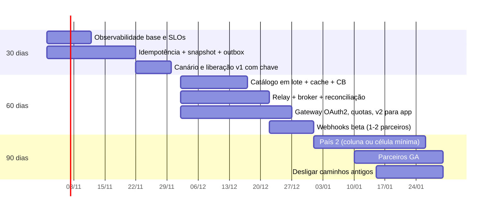

# 06 – Plano de evolução 30/60/90 dias

Princípios: uma mudança por vez em produção, sempre atrás de feature flag ou rota nova, sempre com métrica antes e depois, sempre com rollback testado. Nenhuma janela de indisponibilidade: migrações de banco são só aditivas (*expand*), a limpeza (*contract*) vem depois.

## Dias 1–30: primeira melhoria segura em produção

Objetivo: parar duplicidade e inconsistência na origem, sem mudar nada para o web.

| Entrega | Convivência | Observabilidade | Rollback |
|---------|-------------|-----------------|----------|
| Migração aditiva: tabelas `idempotency_keys`, `outbox`, `order_contact`; colunas de snapshot e `country` (nullable, sem default calculado); índices criados em modo online | Código antigo ignora as novas tabelas/colunas | Tempo de migração, locks | Não precisa: só adiciona. Versão anterior do código roda sobre o esquema novo |
| `POST /v1/orders` aceita `Idempotency-Key` opcional | Sem a chave, comportamento idêntico ao atual | Replays, `422`, `409` por cliente | Flag `idempotency.enabled` |
| Snapshot gravado em todo pedido novo | Pedidos antigos sem snapshot ficam como estão (leitura trata `null`) | % de itens com snapshot | Flag `snapshot.enabled` |
| Gravação na outbox na mesma transação; publicação antiga continua (dual write temporário) | Consumidores atuais não mudam | Diferença entre eventos da outbox e publicados pelo caminho antigo | Flag `outbox.enabled` |
| OpenTelemetry, dashboards e SLOs de criação | – | p95, taxa de erro, burn rate | – |
| `/v2` implantado, fechado (só ambiente de testes e app em desenvolvimento) | Não exposto | – | Rota desligada no gateway |
| Web passa a enviar `Idempotency-Key` no v1 | Mudança no cliente web, sem mudança de contrato | % de criações com chave | Web volta a não enviar |

Liberação: canário 5 % → 25 % → 100 % em 1 semana, com critério de parada: p95 > 500 ms ou taxa de 5xx > 0,1 %. Como o gateway só chega no dia 60, o canário da fase 1 é feito pela própria feature flag (percentual de requisições, com o mesmo cliente sempre no mesmo grupo), sobre o balanceador atual. Linha de base: a observabilidade sobe nos dias 1–10, então há pelo menos uma semana de métricas do comportamento atual antes da primeira flag ligada.

Decisão até o dia 30: parecer jurídico do País 2 define a opção A ou B do [ADR-005](adr/ADR-005-residencia-de-dados-por-celula.md). Sem parecer no dia 30, segue a opção B (a mais segura), e o custo extra fica registrado como risco.

Critério de pronto: Q6, Q8 e Q13 de [04](04-qualidade-e-resiliencia.md) verdes em produção; 0 duplicatas em criações com chave.

## Dias 31–60: escala e abertura para app

| Entrega | Convivência | Observabilidade | Rollback |
|---------|-------------|-----------------|----------|
| Catálogo `GET /products?ids=` + cache + circuit breaker | Caminho N+1 continua atrás de flag | Chamadas ao Catálogo por pedido, hit rate, estado do CB | Flag volta ao N+1 |
| Relay da outbox + broker; consumidores internos migram para os eventos da outbox | Dual write mantido até todos migrarem | Idade da outbox, lag por consumidor | Consumidor volta ao tópico antigo |
| Job de reconciliação | – | Divergências encontradas por dia | – |
| Gateway com OAuth2/OIDC, quotas e roteamento `/v1` e `/v2` | Web segue no `/v1` pelo mesmo host | Uso por versão e por `client_id` | Rota do gateway |
| App móvel em produção no `/v2` | – | p95 e erros do app | Flag por versão do app |
| Webhooks beta com 1–2 parceiros piloto | – | Entregas, retries, DLQ | Desligar assinatura |

Critério de pronto: Q1, Q4, Q5, Q7, Q9, Q10 verdes em teste de carga e caos em homologação.

## Dias 61–90: segundo país e parceiros

| Entrega | Convivência | Observabilidade | Rollback |
|---------|-------------|-----------------|----------|
| País 2 conforme o parecer ([ADR-005](adr/ADR-005-residencia-de-dados-por-celula.md)): opção A ativa `country = <país>` na célula BR; opção B implanta a célula mínima na região (API, banco, relay, cache do Catálogo) | Sem impacto nos pedidos BR | Painéis por país | A: desligar o país no gateway. B: célula sem tráfego até o go-live |
| Parceiros GA no `/v2` com quotas por plano | – | Uso e quota por parceiro | Suspender `client_id` |
| Anúncio de depreciação do `/v1` (`Deprecation`, `Sunset` ≥ 6 meses) | `/v1` continua ativo | Uso do `/v1` por consumidor | – |

Descomissionamento (sempre depois de métrica zerada por 2 semanas):
- Caminho N+1 para o Catálogo: removido no dia ~75.
- Publicação antiga fora da transação (dual write): removida quando todos os consumidores estiverem nos eventos da outbox.
- `/v1`: só após o Sunset (mínimo 6 meses depois do GA do `/v2`), fora do horizonte de 90 dias.

## Redução de risco por fase

| Fase | Maior risco | Como é reduzido antes de chegar em produção | Go/no-go |
|------|-------------|---------------------------------------------|----------|
| 30 dias | Quebrar o web atual | Teste de contrato do consumidor v1 no CI; flags desligadas por padrão; canário por percentual | Q6, Q8, Q13 verdes; zero erro 4xx novo no `/v1` |
| 60 dias | Catálogo em lote e broker sob 10x | Teste de carga com o perfil de Q1; caos em homologação (Catálogo fora, broker fora); app interno usa o `/v2` antes do público (*dark launch*) | Q1, Q4, Q5, Q7, Q9, Q10 verdes |
| 90 dias | Dado pessoal no país errado; parceiro derrubando a API | Parecer jurídico no dia 30; teste `PaisTests` e `Eventos_nao_carregam_dado_pessoal` no CI; quotas antes do GA de parceiros | Parecer assinado; célula (se houver) com tráfego sintético por 1 semana |

## Pontos sem volta

Quase tudo volta por flag. Os passos abaixo não voltam por flag, por isso têm condição explícita:

| Passo | Por que não volta fácil | Condição para executar |
|-------|-------------------------|------------------------|
| Remover a publicação antiga (dual write) | Consumidor que ainda lê o tópico antigo para de receber | Lista de consumidores com dono; todos lendo da outbox há 2 semanas, sem divergência na reconciliação |
| Go-live da célula País 2 (opção B) | Pedidos com dado pessoal passam a existir só lá | Teste de failover e de backup/restore da célula feitos; parecer jurídico |
| Desligar o `/v1` | Consumidor esquecido quebra | Uso zero por 2 semanas; Sunset comunicado há 6 meses |
| Remover colunas ou tabelas antigas (*contract*) | Versão anterior do código deixa de rodar | Só depois de a versão anterior sair de produção; fora dos 90 dias |

## Rollback – regras gerais
- Toda mudança de comportamento tem flag. Desligar flag é o primeiro rollback (≤ 5 min).
- Migração de banco só aditiva nos 90 dias; nenhuma coluna removida antes da versão anterior sair de produção.
- Deploy por anel: BR canário → BR → País 2.
