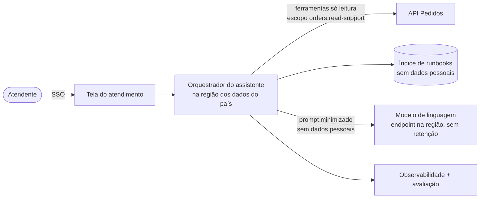

# 08 – Capacidade de IA: assistente de consulta de pedidos para o atendimento

> **Para o avaliador**  
> **Item do PDF:** 2.5.1 Arquitetura e serviços de IA (diferencial)  
> **Critério de avaliação:** Uso eficaz de IA · Segurança e privacidade  
> **O que conferir aqui:** Isolamento, minimização, autorização, guardrails, observabilidade e avaliação (tabela Controles). Prompt de sistema e casos de avaliação em [docs/ia](ia/).

Proposta de piloto após os 90 dias. Não faz parte do caminho crítico.

## Problema
Com app, parceiros e dois países, o atendimento vai receber mais perguntas do tipo "onde está meu pedido", "por que o preço mudou", "o parceiro recebeu a notificação?". Hoje isso exige olhar várias telas e logs.

## O que faz
Assistente interno, só leitura, para atendentes autenticados:
- Resume um pedido: status, histórico, snapshot de preço, entregas de webhook.
- Explica divergências usando dados do pedido + runbooks (ex.: "preço do pedido é o do momento da compra").
- Sugere próximo passo do runbook. Não executa ação.

O que **não** faz: cancelar, reembolsar, alterar pedido, responder direto ao cliente final.

## Arquitetura

## Controles

| Tema | Controle |
|------|----------|
| Isolamento | Um orquestrador por região de dados (por célula, se houver); só acessa a API Pedidos do próprio país. Modelo consumido por endpoint na mesma região, com contrato de não retenção e não treino |
| Minimização | Ferramentas devolvem só campos necessários (status, itens, datas, entregas). Nome, documento, endereço e contato nunca vão para o prompt. IDs são pseudonimizados antes do envio e reidentificados na resposta |
| Autorização | Assistente usa o token do atendente (on-behalf-of), escopo `orders:read-support`. Não tem permissão maior que o atendente |
| Guardrails | Lista fechada de ferramentas só de leitura; conteúdo vindo de pedidos e parceiros tratado como dado, nunca como instrução; resposta precisa citar a fonte (pedido ou runbook); sem fonte, responde "não sei" |
| Observabilidade | Trace por pergunta: ferramentas chamadas, tokens, custo, latência, fontes citadas. Logs sem dados pessoais. Feedback 👍/👎 do atendente |
| Avaliação | Semente com 12 casos em [ia/casos-de-avaliacao.jsonl](ia/casos-de-avaliacao.jsonl), a expandir para 200 perguntas com resposta esperada (dados sintéticos) antes do piloto. Casos de vazamento e de ação fora de escopo são bloqueantes: um erro reprova, não entra na média. Critérios: exatidão ≥ 90 %, 0 vazamento de dado pessoal, 0 ação fora de escopo, taxa de "não sei" correta. Roda a cada mudança de prompt ou modelo |
| Custo | Teto diário de tokens por país; cache de respostas de runbook |

## Critérios para sair do piloto
- Avaliação offline acima dos limites por 4 semanas.
- Redução ≥ 20 % no tempo médio de atendimento de pedidos no grupo piloto.
- Aprovação do DPO (relatório de impacto atualizado).

## Artefatos
- Ferramentas (todas só leitura): `get_order`, `get_webhook_deliveries`, `search_runbook`.
- [Prompt de sistema](ia/prompt-de-sistema.md): regras do assistente. As regras de acesso valem no código; o prompt não é o controle.
- [Casos de avaliação](ia/casos-de-avaliacao.jsonl): semente da suíte offline (normal, pedido inexistente, outro cliente, prompt injection, pedido de ação, falha de ferramenta, dado pessoal).
- Ameaças específicas da IA: T20–T22 no [threat model](05-threat-model.md#ameaças-e-controles).
